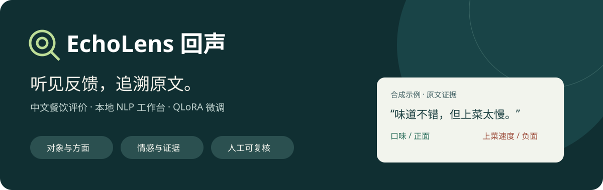

<p align="center"></p>

<p align="center"><a href="https://xiaofei1412.github.io/EchoLens/">项目展示页</a> · <a href="https://github.com/xiaofei1412/EchoLens/releases/tag/v0.1.0">下载 v0.1.0</a> · <a href="docs/releases/v0.1-install.md">安装指南</a> · <a href="MODEL_CARD.md">模型卡</a></p>

# EchoLens 回声

**把中文餐饮评价变成可核对、可追溯的意见。** EchoLens 是本地 NLP 工作台，结合 Qwen3.5-4B 的 QLoRA 微调、方面情感分析、主题发现和连续原文证据，帮助使用者理解具体反馈并形成带依据的报告。

版本 **v0.1.0** · **Apache-2.0** · 本地运行 · 中文餐饮评价。基于ASAP公开数据进行实验，与美团点评、Qwen或餐饮品牌无官方合作或背书关系。

## 可以做什么

| 入口 | 能力 |
| --- | --- |
| 数据导入 | CSV/JSONL字段映射、稳定ID去重、保留来源版本和原文 |
| 分析概览 | 对象、方面、情感和意图；区分原始模型与微调版本，显示失败状态 |
| 主题与证据 | 聚合相近意见，查看代表与边界片段，回到原文核对 |
| 人工复核 | 修订与机器结果分开保存，保留审核和主题变更历史 |
| 报告导出 | 带证据的Markdown报告和审核历史 |

输入超长、输出截断、标签或引用错误会进入复核，不当作可靠证据。主主题至少涉及10条不同反馈，小样本没有主题是正常情况。研究工具和历史演示独立收起，不是日常使用的必经步骤。

## 快速开始

先获取源码：

```powershell
git clone https://github.com/xiaofei1412/EchoLens.git
cd EchoLens
python -m venv .venv-ui
.\.venv-ui\Scripts\python.exe -m pip install -r requirements-ui.txt
$env:ECHOLENS_APP_PYTHON = (Resolve-Path .\.venv-ui\Scripts\python.exe).Path
.\.venv-ui\Scripts\python.exe scripts/start_workbench.py
```

打开 `http://127.0.0.1:8501/`。这个轻量环境不需要GPU库，可以浏览工作台和导入数据；真实分析需要按[完整GPU安装指南](docs/releases/v0.1-install.md)安装推理依赖和模型。

试用 `examples/feedback-import.jsonl`：原文字段选 `feedback`，ID选 `id`，评分可选 `stars`，使用依据选“自有或合成数据”。2条有效记录入库、1条空文本排除。样例是合成文本，不是准确率证明。导入本身不会启动推理。

**已验证环境**：Windows 11 / Python 3.14.6 / RTX 5080 Laptop GPU 16GB。其他系统、CPU推理和其他显卡尚未验证；基础模型缓存经过固定上游revision的内容核验，安装验收是在同一台机器的新隔离环境完成。

## 模型与下载

[GitHub Release v0.1.0](https://github.com/xiaofei1412/EchoLens/releases/tag/v0.1.0) 提供：

- `echolens-v0.1.0-models.zip`：抽取adapter、配套18方面分类器、模型卡和许可，约452MiB。
- `echolens-v0.1.0-source.zip`：源码、配置、文档、测试及合成例句。
- 源码逐文件manifest及 `SHA256SUMS.txt`：校验发布附件。

自有模型包和源码使用配套版本。运行 `scripts/model_bundle.py install` 时按仓库清单校验每个文件，同版跳过、异版拒绝覆盖。Qwen3.5-4B、Qwen3-Embedding-0.6B和编码器基础文件由 `scripts/fetch_release_models.py` 从上游固定revision下载，不重复放入模型包。评论原文、AI标注、历史预测、优化器、缓存与凭据均不随源码分发。

## 实验结果与边界

810条AI辅助标注训练，90条内部开发数据选定第102步adapter。以下是**对AI参考的一致性，不是人工准确率**：

| 90条内部开发集 | 微调前 | 微调后 |
| --- | ---: | ---: |
| 严格证据＋方面＋情感联合F1 | 0.1139 | 0.2527 |
| 宽松联合F1（证据跨度IoU≥0.5） | 0.2425 | 0.5095 |
| 全记录字段合法率 | 75.56% | 97.78% |
| 平均生成耗时 | 36.93秒/条 | 51.25秒/条 |

独立50条字段合法率为48/50，用户整体接受该批结果；实际保存的逐条审核表仅3条，不将其余47条计为“微调胜出”。通过引用和结构检查不代表语义正确。长文遗漏、委婉与讽刺、对象边界仍需复核，生成速度也有代价。

本版专注餐饮，没有跨领域或品牌专属效果承诺，不提供时间趋势。原有1,000条工作台演示属于阶段2基线，并非本版微调成绩。完整训练参数、计分口径和限制见[模型卡](MODEL_CARD.md)、[训练对照](docs/reports/stage3-sft-full-comparison.md)和[阶段3结项](docs/reports/stage3-closeout.md)。

## 项目结构与工程记录

```text
app/              Streamlit工作台与研究页面
src/echolens/     导入、意见验证、统计、主题与审核存储
configs/          固定模型版本、标签、提示及分发清单
scripts/          启动、下载、安装、训练、评测和打包
examples/         可公开的合成导入例句
tests/            数据契约、失败隔离、工作台及分发验证
docs/             静态展示页、指南、聚合报告与开发记录
```

数据、缓存、权重和原始日志只保存在被Git忽略的本地目录。历史训练脚本保留用于研究；未分发的AI标注意味着不能承诺仅凭公开代码精确重现相同训练权重。

[运行与UI指南](docs/running-workbench.md) · [数据卡](docs/data/asap.md) · [开发记录](docs/development/README.md) · [发布验证](docs/reports/v0.1-release-preparation.json) · [更新日志](CHANGELOG.md)

## 许可

项目原创代码和自有模型修改采用[Apache-2.0](LICENSE)。第三方模型、数据和依赖保留各自许可与版权声明，见[NOTICE](NOTICE)和[来源与归因](THIRD_PARTY_NOTICES.md)。项目许可证不授予第三方评论或品牌的额外权利。
